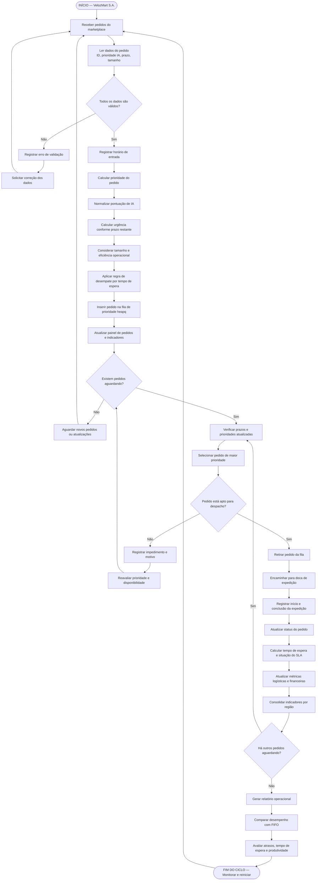

# Marketplace Priority Sorter — VelozMart S.A.

Fila de prioridade para expedição de pedidos de um marketplace, implementada em Python com **Min-Heap (`heapq`)**. O sistema decide qual pedido deve sair primeiro combinando prioridade comercial, tamanho do pacote e prazo restante (SLA), recalculando as prioridades dinamicamente conforme o tempo passa.

---

## Funcionalidades

- Validação rigorosa dos dados de cada pedido (prioridade, prazo e tamanho).
- Cálculo de urgência não-linear por pedido.
- Fila ordenada com critérios de desempate bem definidos.
- Pedidos atrasados furam a fila automaticamente.
- Simulação da passagem do tempo com reconstrução eficiente do heap em $O(N)$.
- Exibição formatada da fila em consola sem destruir a estrutura do heap.

---

## Como Funciona

### 1. Fórmula de Urgência

$$\text{Urgência} = \frac{\text{Prioridade} \times \text{Peso}_{\text{Tamanho}}}{\max(\text{Prazo}, 1)}$$

| Tamanho | Peso |
| :---: | :---: |
| **P** | 1.0 |
| **M** | 1.2 |
| **G** | 1.5 |

O `max(Prazo, 1)` evita divisão por zero caso o SLA expire. Quanto maior o valor resultante de urgência, mais cedo o pedido é expedido.

### 2. Critérios de Ordenação (Simulação de Max-Heap)

Como o módulo `heapq` do Python implementa nativamente um **Min-Heap** (o menor valor fica sempre no topo), cada pedido é convertido numa tupla onde os valores de prioridade máxima têm o sinal invertido:

```python
(-int(atrasado), -urgencia, prazo, contador, pedido)
```

A comparação ocorre da esquerda para a direita:
1. **Atrasados primeiro (`-int(atrasado)`):** Pedidos com `prazo <= 0` recebem `-1` e pedidos dentro do prazo recebem `0`. Como `-1 < 0`, os atrasados assumem o topo absoluto da fila.
2. **Maior urgência (`-urgencia`):** O sinal negativo faz com que a maior urgência matemática se torne o menor número relativo (ex: `-150.0` vem antes de `-80.0`), emulando um Max-Heap.
3. **Menor prazo restante (`prazo`):** Se dois pedidos empatarem na urgência, vence aquele cujo SLA está mais próximo de estourar.
4. **Ordem de chegada FIFO (`contador`):** Persistindo o empate, o `itertools.count()` gera um inteiro sequencial único que garante que o pedido recebido primeiro saia primeiro, evitando que o Python tente comparar objetos `Pedido` diretamente.

### 3. Complexidade Computacional

| Operação | Custo | Explicação Técnica |
| :--- | :--- | :--- |
| `adicionar()` | $O(\log N)$ | Inserção na árvore binária via `heappush`. |
| `despachar()` | $O(\log N)$ | Remoção da raiz e reequilíbrio via `heappop`. |
| `atualizar_tempo()` | $O(N)$ | Reconstrução linear in-place utilizando o algoritmo de Floyd (`heapify`). |

---

## Estrutura e Explicação do Código

| Componente | Responsabilidade |
| :--- | :--- |
| **`Pedido`** | Modela a entidade individual. Valida regras de negócio no `__init__`, armazena os pesos de cubagem (`PESOS_TAMANHO`) e aplica a equação não-linear no método `calcular_urgencia()`. |
| **`MarketplacePrioritySorter`** | Gere o ciclo de vida da fila. Encapsula a lista do heap, o gerador `count()`, a formatação tabular não-destrutiva (`sorted(self.fila)`) e os métodos de transição de estado (`adicionar`, `atualizar_tempo`, `despachar`). |

---

## Código-Fonte Completo (`main.py`)

```python
from itertools import count
import heapq


class Pedido:
    """Representa um pedido individual aguardando expedição."""

    PESOS_TAMANHO = {"P": 1.0, "M": 1.2, "G": 1.5}

    def __init__(self, id_pedido: str, prioridade: float, prazo: int, tamanho: str):
        if not (0 <= prioridade <= 100):
            raise ValueError("A prioridade deve estar entre 0 e 100.")
        if prazo < 0:
            raise ValueError("O prazo inicial não pode ser negativo.")
        if tamanho not in self.PESOS_TAMANHO:
            raise ValueError("Tamanho inválido! Use apenas 'P', 'M' ou 'G'.")

        self.id_pedido = id_pedido
        self.prioridade = prioridade
        self.prazo = prazo
        self.tamanho = tamanho
        self.urgencia = 0.0

    def calcular_urgencia(self) -> float:
        """
        Fórmula não-linear: Urgência = (Prioridade * PesoTamanho) / max(Prazo, 1)
        Quanto maior o resultado, maior a prioridade de envio.
        """
        peso = self.PESOS_TAMANHO[self.tamanho]
        # max(self.prazo, 1) evita divisão por zero
        self.urgencia = (self.prioridade * peso) / max(self.prazo, 1)
        return self.urgencia

    def __repr__(self):
        return f"<Pedido Prazo: Urgência: {self.id_pedido} {self.prazo}m {self.urgencia:.2f} |>"


class MarketplacePrioritySorter:
    """Gerenciador da fila de prioridade usando Min-Heap (heapq)."""

    def __init__(self):
        self.fila = []
        self.contador = count()  # Garante desempate FIFO estável

    def criar_item(self, pedido: Pedido):
        """
        Cria a tupla de ordenação para o Min-Heap:
        1º: -int(atrasado) -> -1 vem antes de 0 (pedidos atrasados furam a fila).
        2º: -urgencia      -> Inverte sinal para emular Max-Heap (maior urgência primeiro).
        3º: pedido.prazo   -> Menor prazo restante ganha o desempate.
        4º: contador       -> Desempate FIFO (ordem de chegada).
        5º: pedido         -> Objeto de dados.
        """
        urgencia = pedido.calcular_urgencia()
        atrasado = pedido.prazo <= 0

        return (
            -int(atrasado),
            -urgencia,
            pedido.prazo,
            next(self.contador),
            pedido,
        )

    def adicionar(self, pedido: Pedido):
        """Insere um novo pedido no Heap em tempo O(log N)."""
        heapq.heappush(self.fila, self.criar_item(pedido))

    def mostrar_fila(self, titulo: str):
        """Exibe a fila formatada em tela sem destruir a estrutura do Heap."""
        print("\n" + "=" * 90)
        print(f" {titulo.upper()} ")
        print("=" * 90)
        print(
            f"{'Pos.':<5} {'Pedido':<12} {'Prior.':>7} "
            f"{'Prazo':>8} {'Tam.':>6} {'Urgência':>10} "
            f"{'Situação':<14}"
        )
        print("-" * 90)

        # Ordena uma cópia apenas para exibição visual
        for posicao, item in enumerate(sorted(self.fila), start=1):
            pedido = item[4]

            if pedido.prazo <= 0:
                situacao = " ATRASADO"
            elif pedido.prazo <= 15:
                situacao = " CRÍTICO"
            elif pedido.prazo <= 60:
                situacao = " ATENÇÃO"
            else:
                situacao = " NO PRAZO"

            print(
                f"{posicao:<5} {pedido.id_pedido:<12} "
                f"{pedido.prioridade:>7} "
                f"{pedido.prazo:>7}m "
                f"{pedido.tamanho:>6} "
                f"{pedido.urgencia:>10.2f} "
                f"{situacao:<14}"
            )

    def explicar_ordem(self):
        """Explica as regras de negócio aplicadas."""
        print("\n CRITÉRIOS DE ORDENAÇÃO:")
        print(" 1. Pedidos com prazo vencido têm prioridade máxima absoluta.")
        print(" 2. Entre os válidos, maior urgência calculada sai primeiro.")
        print(" 3. Empate de urgência: menor prazo restante vence.")
        print(" 4. Persistindo empate: ordem de chegada (FIFO).")
        print(" 5. Pacotes maiores (G e M) recebem peso extra para liberar docas.")

    def atualizar_tempo(self, minutos: int):
        """
        Simula a passagem do tempo.
        Atualiza todos os prazos e reconstrói o heap via Floyd em O(N).
        """
        if minutos < 0:
            raise ValueError("O tempo decorrido não pode ser negativo.")

        pedidos = [item[4] for item in self.fila]
        nova_fila = []

        for pedido in pedidos:
            pedido.prazo -= minutos
            nova_fila.append(self.criar_item(pedido))

        heapq.heapify(nova_fila)
        self.fila = nova_fila

        print(f"\n Tempo avançado em {minutos} minutos. Prioridades recalculadas em O(N).")

    def despachar(self):
        """Remove e expede o pedido de maior prioridade em tempo O(log N)."""
        if not self.fila:
            print("Não existem pedidos na fila para despacho.")
            return None

        _, _, _, _, pedido = heapq.heappop(self.fila)

        status = " FORA DO PRAZO" if pedido.prazo <= 0 else " DENTRO DO PRAZO"

        print(
            f"\n PEDIDO DESPACHADO: {pedido.id_pedido} | "
            f"Urgência: {pedido.urgencia:.2f} | "
            f"Prazo Restante: {pedido.prazo}m | Status: {status}"
        )
        return pedido


# ==========================================
# EXECUÇÃO DO FLUXO COMPLETO DO CENÁRIO
# ==========================================
if __name__ == "__main__":
    sistema = MarketplacePrioritySorter()

    # Base de testes fornecida no projeto
    dados_pedidos = [
        ("ORD-001", 90, 120, "P"),
        ("ORD-002", 60, 15,  "M"),
        ("ORD-003", 40, 180, "G"),
        ("ORD-004", 85, 30,  "P"),
        ("ORD-005", 70, 45,  "M"),
        ("ORD-006", 95, 240, "G"),
        ("ORD-007", 55, 10,  "P"),
        ("ORD-008", 80, 60,  "M"),
        ("ORD-009", 30, 5,   "G"),
        ("ORD-010", 75, 90,  "P"),
        ("ORD-011", 65, 20,  "G"),
        ("ORD-012", 50, 75,  "M"),
    ]

    print("ETAPA 1 — RECEBIMENTO DOS PEDIDOS NO SISTEMA...")
    for id_p, prioridade, prazo, tamanho in dados_pedidos:
        sistema.adicionar(Pedido(id_p, prioridade, prazo, tamanho))

    # Etapa 2: Classificação Inicial
    sistema.mostrar_fila("ETAPA 2 — CLASSIFICAÇÃO INICIAL")
    sistema.explicar_ordem()

    # Etapa 3: Primeiro Despacho
    sistema.despachar()

    # Etapa 4: Simulação de passagem do tempo (12 minutos)
    sistema.atualizar_tempo(12)
    sistema.mostrar_fila("ETAPA 4 — FILA APÓS 12 MINUTOS (DECAIMENTO DE SLA)")

    # Etapa 5: Segundo Despacho
    sistema.despachar()

    # Etapa 6: Estado Final da Fila
    sistema.mostrar_fila("ETAPA 6 — PEDIDOS RESTANTES AGUARDANDO EXPEDIÇÃO")
```

---

## Cenário de Demonstração

Ao executar, o `main.py` corre 6 etapas com 12 pedidos de exemplo:
1. Recebimento dos pedidos.
2. Classificação inicial da fila.
3. Primeiro despacho.
4. Passagem de 12 minutos (decaimento de SLA) e nova classificação.
5. Segundo despacho.
6. Estado final da fila.

**Situação exibida por pedido:**

| Prazo restante | Situação |
| :--- | :--- |
| `<= 0` | ATRASADO |
| `<= 15 min` | CRÍTICO |
| `<= 60 min` | ATENÇÃO |
| `> 60 min` | NO PRAZO |

---

## Fluxograma do Sistema (MPS)


